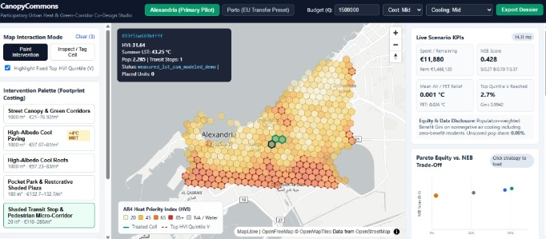
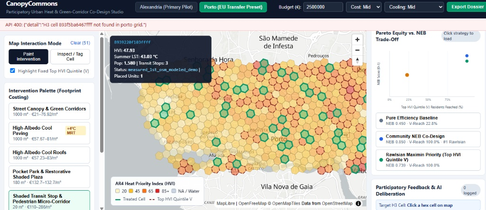
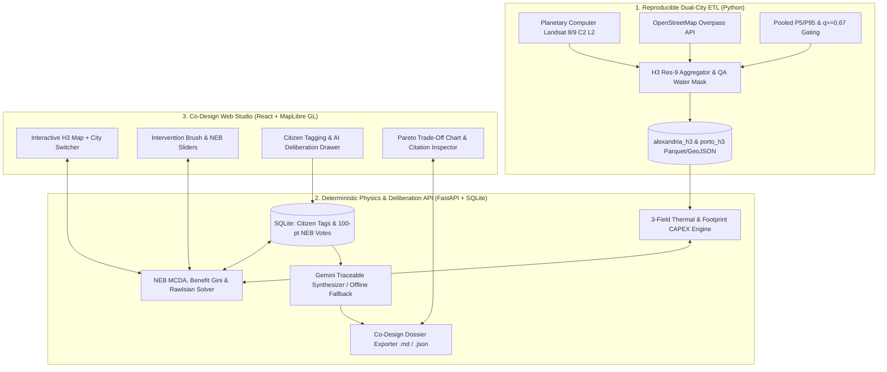

# CanopyCommons
**Participatory Urban Heat & Green-Corridor Co-Design Simulator**

CanopyCommons is a city-agnostic spatial decision-support studio aligned with **SDG 11.7** (inclusive green public spaces), **SDG 13.1** (urban climate resilience), and **SDG 10.2** (equitable resource allocation). It pairs deterministic urban-heat modeling with **New European Bauhaus (NEB)** participatory co-design (**Sustainable, Beautiful, Together**) and citation-checked AI deliberation.

* **Primary Case Study:** **Alexandria, Egypt** (dense coastal core: El Manshia, Karmouz, Moharam Bek, Bab Shark, Sidi Gaber, First Raml) — grounded in local coastal heat gradients and unshaded transit corridors.
* **EU Transferability Benchmark:** **Porto, Portugal** (CAOP 1312 municipality) — validating the same H3 pipeline and pooled normalization on European open data.



---

## Verified Dual-City Benchmark Results (Live Landsat 8/9 + OSM)

Both cities run on **Uber H3 Resolution 9** grids (10.53 ha mean cell area) using **pooled, equal-city-weighted P5/P95 normalization**, strict **weight-coverage NA gating ($q \ge 0.67$)**, and sub-20 ms FastAPI simulation latency:

| City & Budget | Scored H3 Cells (Water Masked) | Unscored Pop Share | Strategy | NEB Score (0–1) | Top HVI Quintile ($V$) Reached |
| :--- | :---: | :---: | :--- | :---: | :---: |
| **Alexandria** (€1.5M) | 363 / 554 | 0.00% | Pure Efficiency Baseline | 0.464 | 26.6% |
| **Alexandria** (€1.5M) | 363 / 554 | 0.00% | Community NEB Co-Design | 0.499 | 46.4% |
| **Alexandria** (€1.5M) | 363 / 554 | 0.00% | **Rawlsian Maximin Priority (#1)** | **0.518** | **50.7%** |
| **Porto** (€2.5M) | 519 / 545 | 0.12% | Pure Efficiency Baseline | 0.435 | 22.8% |
| **Porto** (€2.5M) | 519 / 545 | 0.12% | **Community NEB / Rawlsian (#1)** | **0.865** | **100.0%** |

> **Headline Finding:** Under the same **€1.5M Alexandria budget**, shifting from pure efficiency optimization to Rawlsian priority nearly doubles heat-relief reach across the most vulnerable baseline HVI quintile (**26.6% → 50.7%**) while lifting the NEB composite score (**0.464 → 0.518**).



---

## Scientific & Participatory Guardrails

1. **Decoupled Spatial Grain:** Neighborhood heat priority ($HVI_i = 100[E_i + S_i + (1-A_i)]/3$) is reported on H3 Resolution 9, while CAPEX and experienced person-minute benefits ($b_{im} = \sum_k h_{ik}\Delta T_{km}/\sum_k h_{ik}$) are computed at the actual intervention footprint (e.g., 20 m² transit shelter vs. 1,000 m² street corridor).
2. **Three Distinct Temperature Fields:** Keeps **Land Surface Temperature (LST)**, **2 m outdoor air temperature**, and **pedestrian Physiological Equivalent Temperature (PET)** strictly separate (e.g., shaded transit stops yield 0.6–1.0 °C air cooling alongside 17.3–18.7 °C PET relief; Dzyuban et al., `DOI:10.1007/s00484-021-02074-4`).
3. **Signed Pedestrian Warming Disclosure:** Placing **High-Albedo Cool Paving** triggers a dedicated **+4.0 °C midday Mean Radiant Temperature (MRT)** warning with affected population counts alongside a gain-only Benefit Gini label (Middel et al. 2020, `DOI:10.1088/1748-9326/ab87d4`).
4. **Human-in-the-Loop AI Deliberation:** Gemini synthesis (Google AI Studio) clusters free-text resident comments into structured JSON planning themes with strict database citation validation (`feedback_id` + `h3_index`) and **zero silent mutation** of active weights.

---

## System Architecture



---

## Reproducible Quickstart

### 1. Backend & Automated BDD Verification
```bash
pip install -r requirements.txt
python -m etl.validate_grid                    # Verify committed live Alexandria + Porto H3 grids
python -m pytest -v backend/tests/             # Run all 6 BDD & integration acceptance tests
python -m uvicorn backend.app.main:app --port 8000
```
*(Optional: set `GEMINI_API_KEY` from Google AI Studio before running `uvicorn` for live Gemini 2.5 Flash deliberation; otherwise the deterministic traceable fallback runs automatically.)*

### 2. Frontend Co-Design Studio
```bash
cd frontend
npm install
npm run dev
```
Open `http://localhost:5173`. To re-pull fresh satellite and OSM layers from scratch:
```bash
python -m etl.build_grid --city all --mode live
```

---

## Documentation & Governance
* [docs/URD.md](docs/URD.md) — Frozen User Requirements Document & Gherkin BDD acceptance suite.
* [docs/METHODOLOGY.md](docs/METHODOLOGY.md) — Peer-reviewed cooling coefficients, CAPEX benchmarks, dataset endpoints, and DOIs.
* [docs/adr/0001-dual-city-h3-metrics.md](docs/adr/0001-dual-city-h3-metrics.md) — Architectural Decision Record.

## Known Limitations & Roadmap (v1.1)
* **Population & Age Sensitivity:** Current live ETL pairs measured Landsat 8/9 LST and live OSM infrastructure with modeled demographic baselines (`measured_lst_osm_modeled_demo`). Because GHS-POP estimates total residential counts across all ages while 65+ shares require a separate age grid, v1.1 adds pixel-conserving GeoTIFF clipping for both sources and reports which H3 cells enter or leave the top baseline HVI quintile ($V$) under alternative age assumptions.
* **Daytime Overpass Thermal Scope:** Baseline exposure ($E$) uses clear-sky summer daytime Landsat 8/9 LST (~10:30 local overpass) rather than nocturnal urban heat-island intensity. Nighttime air temperature remains unassessed until paired urban–reference overnight observations (or Porto's VITO UrbClim air-temperature archive) are integrated as a validation overlay.
* **Transferred Site-Level Cooling Bounds:** Footprint cooling magnitudes (e.g., 17.3–18.7 °C PET relief for a 20 m² transit shelter and +4.0 °C midday MRT warming on reflective paving) are literature-cited scenario bounds rather than locally instrumented Alexandria measurements. v1.1 adds waiting-time sensitivity bounds and paired local microclimate calibration.
* **Unverified Field Participation:** The SQLite tagging workflow, 100-point NEB stratification, and Gemini citation-checked deliberation prove technical governance rules, not empirical citizen recruitment. Any pre-field entries are labeled as synthetic test inputs; field validation requires walk-along transit-queue audits and a published decision log tracking resident disagreements and changed allocations.
* **Cross-City Equity & Weight Dependence:** Portfolio rankings depend on represented strata, chosen NEB weights, and cell data coverage ($q \ge 0.67$). CanopyCommons publishes each city's unscored population share (`0.00%` Alexandria, `0.12%` Porto) alongside every scenario and plans full weight-perturbation rank stability checks across both cities.